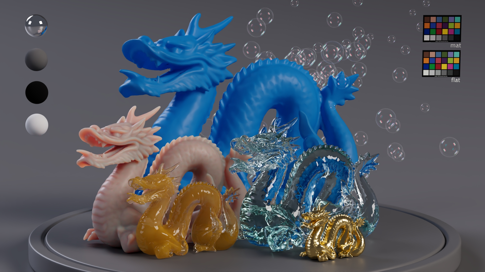
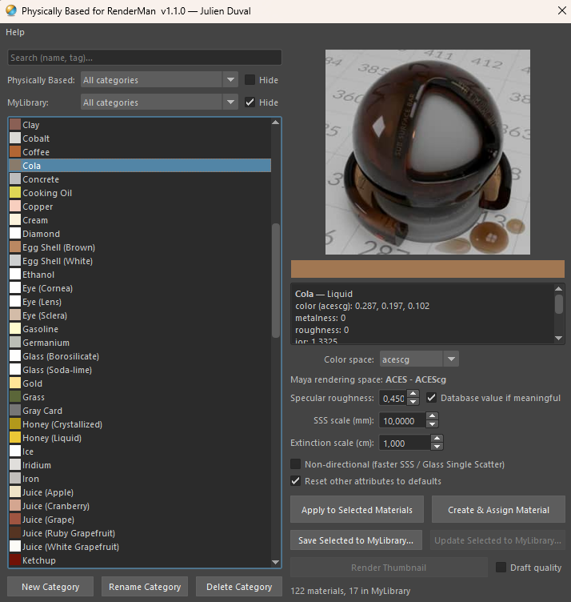
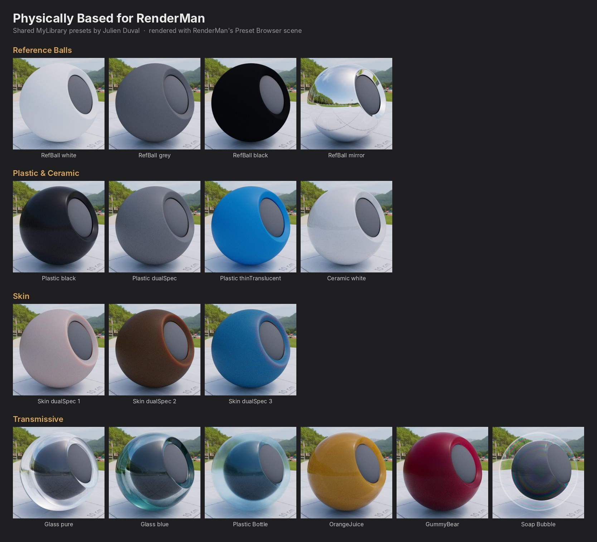

# Physically Based for RenderMan

**Real-world material values for PxrSurface in Maya.**

Browse the [Physically Based](https://physicallybased.info) material database from inside Maya and set up a `PxrSurface` from measured values in one click: metals with real complex IOR, glass and liquids with Beer–Lambert interior absorption, scattering media, skin subsurface and thin-film iridescence. Everything is converted to your scene's rendering space (ACEScg or linear sRGB).

Author: **Julien Duval** · Version **1.1.0** · License **MIT**



*Dragons shaded with the tool, mixing materials straight from the Physically Based database (gold) and the shared MyLibrary presets (blue plastic…). Rendered in RenderMan by Julien Duval.*



---

## Requirements

- Maya 2022 or later (Python 3, PySide2 or PySide6)
- RenderMan for Maya 24 or later (developed and tested with 27.2). *Render Thumbnail* uses the Preset Browser's internals, which RenderMan may change between versions: if a version breaks it, the error says so and the rest of the tool keeps working.
- Internet access on first launch (the database is then cached for a week)

## Installation

1. Copy the `pb_renderman` folder into your Maya scripts folder:
   - Windows: `Documents\maya\scripts\` (all versions) or `Documents\maya\<version>\scripts\`
   - macOS: `~/Library/Preferences/Autodesk/maya/scripts/`
   - Linux: `~/maya/scripts/`

   ```
   scripts/
     pb_renderman/
       __init__.py
       pb_renderman.py
       README.txt
       pb_renderman.png, pb_renderman_150.png, pb_renderman_200.png, pb_renderman.svg   (icon)
       presets/   (shared presets, copied into MyLibrary at launch)
   ```
2. Create the shelf button (once), in the Script Editor (Python tab):
   ```python
   import pb_renderman
   pb_renderman.install_shelf_button()
   ```
   A button with the tool's icon is added to the current shelf; Maya saves it when it quits.
3. Click the button to open the tool.

The button runs `import pb_renderman; pb_renderman.show()`, which you can also run from the Script Editor. It reloads the tool each time, so an updated `pb_renderman.py` is picked up without restarting Maya.

If an older single-file version (`scripts\pb_renderman.py`) was used in the current Maya session, delete that file and restart Maya once.

## Usage

1. Pick a material in the list (search by name or tag). Two menus filter the list: **Physically Based** (the database categories) and **MyLibrary** (your categories); the **Hide** checkbox next to each one hides its materials. The panel shows the database render, the values and exactly what will be set.
2. Choose an action:
   - **Apply to Selected Materials**: updates the `PxrSurface` nodes that are selected, or assigned to the selected objects. Creates nothing.
   - **Create & Assign Material**: creates a new `PxrSurface` + shading group and assigns it to the selected objects or faces (or creates it unassigned).

Every action is a single undo step. Attributes connected to a texture or pattern are never overwritten.

### MyLibrary: your own presets

The **MyLibrary** category lists your own PxrSurface presets, stored in their own folder, shared by all Maya versions and kept apart from Maya's preset folders:
`Documents\maya\physicallybased_MyLibrary\` (Maya's user folder)

- They are applied exactly as saved, with the same two buttons. Only *Non-directional (faster SSS / Glass Single Scatter)* applies to them; the other options do not.
- **Save Selected to MyLibrary…** saves the selected PxrSurface (or the one assigned to the selected object) as a new preset. The files use Maya's attribute-preset format (`.mel`), so you can also copy one into Maya's own preset folder if you want it in the Attribute Editor's *Presets* menu.
- **Update Selected to MyLibrary…** overwrites the preset picked in the list with the selected PxrSurface, keeping its name, category and thumbnail file (render the thumbnail again to refresh it).
- **Categories**: the *New Category*, *Rename Category* and *Delete Category* buttons under the list manage them (Rename and Delete act on the category picked in the MyLibrary menu). A category is a subfolder of the library; deleting one moves it, with its presets, to `_trash`. New presets are saved in the category picked in the menu.
- **Right-click a MyLibrary preset** in the list: Rename…, Render Thumbnail, Move to category or Delete…. Render Thumbnail and Move to category act on all the selected presets (Ctrl / Shift-click), and Move to category can create a new category on the way. Renaming and moving also take the preview images.
- **Delete…** (right-click) moves the preset (and its preview image) to the `_trash` subfolder of the library, so it can be restored.
- **Render Thumbnail** renders the selected preset in RenderMan's own Preset Browser preview scene (same scene and renderer, lit by RenderMan's factory Annecy HDRI, +0.5 stop), at 256 px (the browser renders 128 px) with up to 512 samples, converted to Maya's display/view transform, and saves it next to the `.mel` as a `.png`. Ctrl / Shift-click several presets to render their thumbnails one after the other (Esc cancels). Tick *Draft quality* for faster, noisier thumbnails (4–64 samples, pixel variance 0.1). You can also use your own `.png` or `.jpg` with the same name as the `.mel`.
- MyLibrary is available even when the database cannot be downloaded.

### Shared presets

The tool ships with presets by **Julien Duval** (reference balls, plastics, ceramic, skin, glass, liquids…) in its `presets` folder, laid out like MyLibrary (category subfolders, `.mel` + `.png`). At launch they are copied into your MyLibrary:
- a new shared preset is added, unless you already have a preset with the same name;
- an updated shared preset replaces your copy only if you have not modified it;
- a shared preset you deleted or modified is left alone.

What was installed is tracked in `physicallybased_MyLibrary\.pb_shared_presets.json`.



### Options

| Option | Default | What it does |
|---|---|---|
| Color space | auto | Detected from Maya's rendering space (ACEScg or linear sRGB). The Maya rendering space is shown below it. |
| Specular roughness | 0.45 | Default roughness. Transmissive materials use 0.001. |
| Database value if meaningful | on | Uses the database roughness when it is not 0 or 0.5 (generic placeholders), e.g. brick 1.0, paper 0.8. |
| SSS scale (mm) | 10 | Multiplier on the database subsurface radius (mm) → `subsurfaceDmfp`. |
| Extinction scale (cm) | 1 | Multiplier on interior extinction. Coefficients are treated as per cm: 1 for a scene in cm, 100 in meters. |
| Non-directional (faster SSS / Glass Single Scatter) | off | Replaces directional scattering by isotropic scattering: reduced scattering with `g` = 0 in the glass interior, Directionality 0 for subsurface and single scatter. Similar look, much faster. Also applies to MyLibrary presets (the files are not changed). |
| Reset other attributes to defaults | on | *Apply* only: resets every unconnected attribute to its default before applying. |

Right-click an option (its name or its control) to reset it to its default value.

**Help** menu: the *User Guide* (F1), links to MyLibrary, the Physically Based website and GitHub, and *About* (version, credits, license).

## How materials are mapped

**Opaque dielectrics**: `diffuseColor` from the database color, Primary Specular in GGX with physical Fresnel and the database IOR.

**Metals**: Primary Specular with physical Fresnel and per-channel complex IOR (n, k) in the scene's color space. When the database n, k do not match the material color (tinted variants such as anodized aluminum), n, k are derived from color + edge tint with Gulbrandsen's inverse mapping.

**Transmissive materials** (glass, water, liquids, plastics, gems): the Glass lobe only, for refraction *and* reflection. The Primary Specular is left untouched and the diffuse color is not changed. The tint comes from the interior:
- `extinction` from the database volume coefficients, or from color + transmission depth (Beer–Lambert, `σ = −ln(color) / depth`)
- `ssAlbedo` and `g` (the interior *g0* parameter) from the database scattering and anisotropy
- `multiScatter` enabled whenever the single-scatter albedo is above 0

**Subsurface**: `subsurfaceColor` from the color, `subsurfaceDmfp` / `subsurfaceDmfpColor` from the database radius. Skin uses a Directionality of 0.8. Whenever subsurface is on (`subsurfaceGain` > 0, database materials and MyLibrary presets alike), *Resolve Self Intersections* is enabled.

**Thin film** (soap bubble, pearl, anodized titanium): Iridescence lobe in Physical mode with the database thickness. PxrSurface has no film IOR, so its face gain is set to the film's normal-incidence reflectance `((n − 1) / (n + 1))²`.

### Color space conversion

The database provides ACEScg and linear sRGB values for most colors and metals. When only sRGB exists, colors go through the Bradford sRGB → ACEScg matrix. Volume coefficients are never put through that matrix: extinction is converted through transmittance and albedo through the multiple-scattering diffuse reflectance, which are the quantities you actually see.

### Overrides

Three settings at the top of the script hold per-material overrides:
```python
SSS_DIRECTIONALITY  = {"Skin": 0.8}                    # by name prefix
FORCE_ISOTROPIC     = ("Blood", "Coffee")              # by name prefix
THIN_FILM_OVERRIDES = {"Titanium (Anodized)": 300.0}   # nm, by exact name
```
Blood and coffee are always rendered non-directional: they are dense and strongly forward-scattering (blood: g ≈ 0.99, about 900 scattering events per cm), so directional mode needs far too many light bounces to be usable.

## Known limitations

- **Volume units are inferred.** The database does not state the unit of its volume coefficients. Per cm matches the measured absorption of water and the glass/water/ice depths, but some liquids look about ten times off. Use *Extinction scale* to adjust.
- **RenderMan's built-in metal presets are defined in linear sRGB** and are not converted for ACEScg scenes, so they will differ slightly from this tool in an ACEScg scene. This tool's values are the color-managed ones.
- Per-channel (RGB) n, k and volume coefficients are an approximation of spectral data.

## Files

The database is cached in `Documents\maya\physicallybased_cache\` (or `MAYA_APP_DIR`, or the temp folder). Delete it at any time; it is rebuilt on the next launch.

Your presets live in `Documents\maya\physicallybased_MyLibrary\`. Back this folder up: it is your own data.

## Thanks

A special thank you to **Anton Palmqvist** and all the **contributors** of [Physically Based](https://physicallybased.info). This tool exists because they measured, gathered and freely shared these values with the CG community. If you find a missing material or a wrong value, consider [contributing to the database](https://github.com/AntonPalmqvist/physically-based-api).

## Credits

- Author: Julien Duval
- Developed with the assistance of Claude (Anthropic)
- Shared MyLibrary presets and thumbnails: Julien Duval (MIT, like the tool)
- Material data: [Physically Based API](https://api.physicallybased.info), CC0, by Anton Palmqvist and contributors

Independent project, not affiliated with or endorsed by Pixar, Autodesk or physicallybased.info. RenderMan is a trademark of Pixar; Maya is a trademark of Autodesk.

## License

MIT, see [LICENSE](LICENSE).
